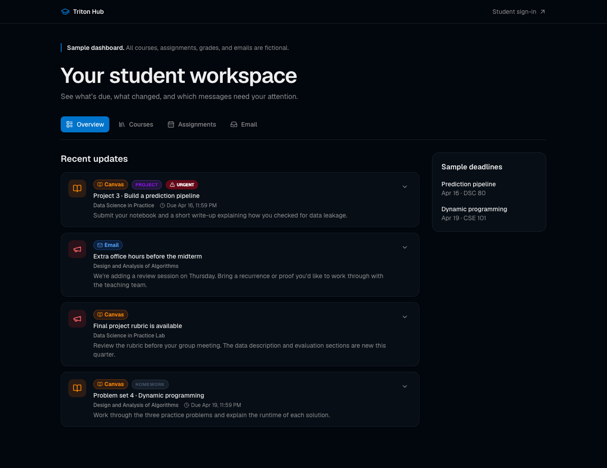

# Triton Hub

**A student dashboard for UC San Diego.** See Canvas assignments, course announcements, academic email, and personal deadlines in one place.

[Explore the interactive demo](https://triton-hub-showcase.vercel.app/demo) · [Set up a student workspace](docs/setup.md)



The sample dashboard uses fictional records and needs no sign-in. Browse courses, filter the feed to assignments or email, and expand an update to see its details.

## What we built

- **Canvas coursework** — Browse courses and grades, see upcoming assignments, and read announcements.
- **Unified feed** — Combine Canvas updates and optionally connect a Gmail inbox to surface academic messages.
- **Personal calendar** — Add deadlines and events and track completion across sessions.

## Run the demo locally

With Node.js 24 and npm:

```bash
git clone https://github.com/Thaarak/Triton-Hub.git
cd Triton-Hub/triton-hub
npm ci
npm run dev
```

Open [localhost:3000/demo](http://localhost:3000/demo). To check changes, run `npm run lint` and `npm run build` from the same directory.

## How it works

| Path | Role |
| --- | --- |
| [`triton-hub/`](triton-hub/) | Next.js dashboard, sample data, Supabase sign-in, and server-side Canvas and Gmail routes |
| [`supabase/migrations/`](supabase/migrations/) | Profile, calendar and notification storage, and access policies for encrypted integration credentials |
| [`backend/`](backend/) | Original Flask OAuth and sync experiments retained as project history |

The [workspace setup guide](docs/setup.md) covers Supabase, Google sign-in, Canvas, optional Gmail, and deployment verification.

## Team and contributions

Built by Thaarak Sriram, Rayirth Dinesh, Siddharth Maddikayala, and [shrivassudharsan1](https://github.com/shrivassudharsan1). See the [commit history](https://github.com/Thaarak/Triton-Hub/graphs/contributors) for individual contributions.

Thaarak integrated live Canvas data into the [assignments](https://github.com/Thaarak/Triton-Hub/commit/c533f79) and [announcements](https://github.com/Thaarak/Triton-Hub/commit/d20aa46) views and built [calendar event persistence](https://github.com/Thaarak/Triton-Hub/commit/bcce2f1) and [completion tracking](https://github.com/Thaarak/Triton-Hub/commit/954c6ca) with Supabase.
